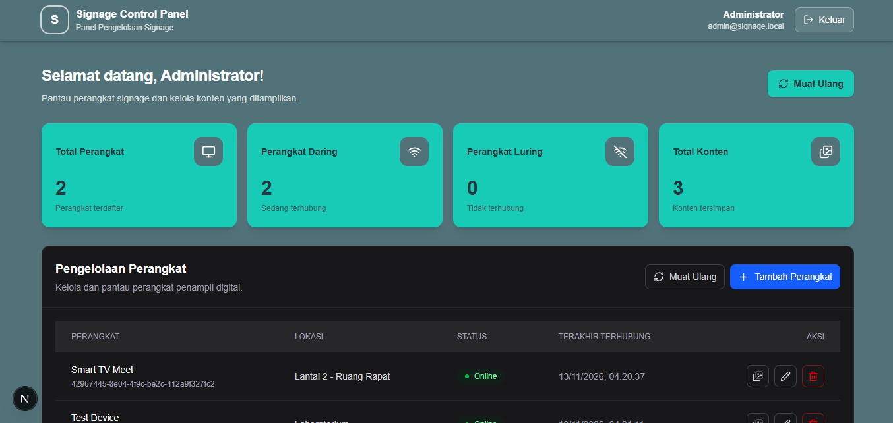
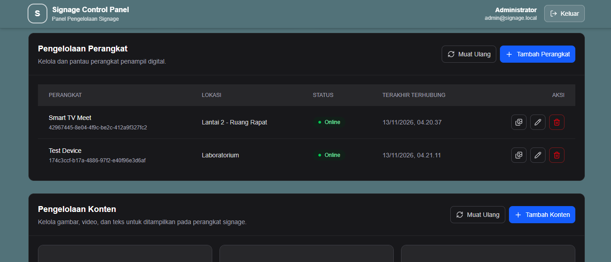
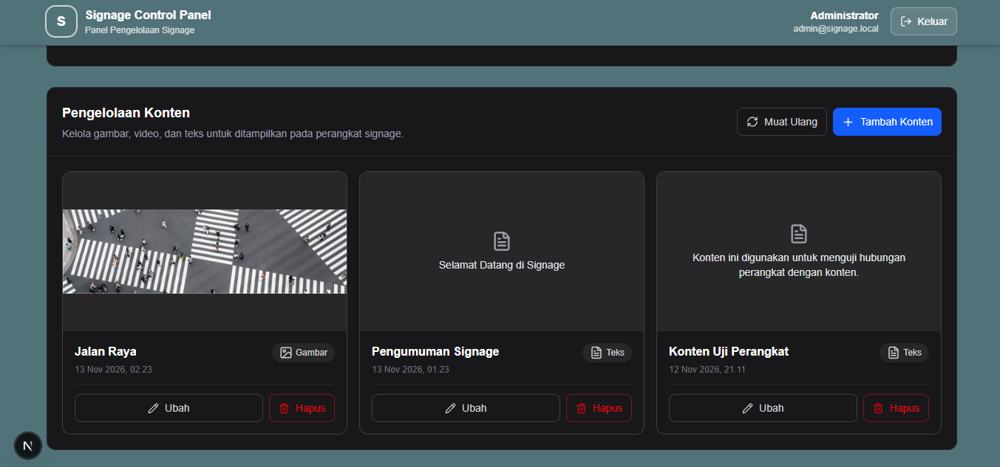
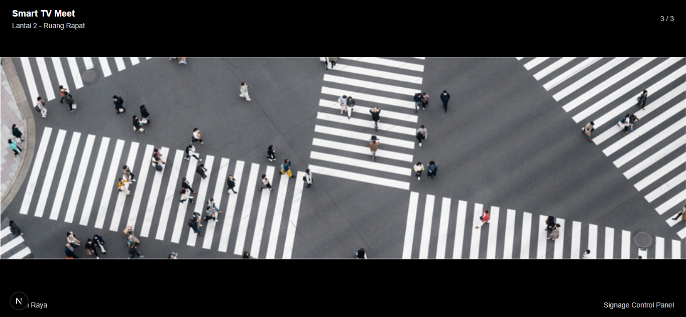

# 📺 Signage Control Panel

<p align="center">
  <strong>Sistem Pengelolaan Digital Signage Berbasis Web dengan Pemantauan Perangkat Secara Real-Time</strong>
</p>

<p align="center">
  
  
  
  
  
  
  
  
</p>

---

## 📖 Tentang Proyek

**Signage Control Panel** merupakan aplikasi pengelolaan *Digital Signage* berbasis web yang memungkinkan administrator mengelola perangkat signage dan konten yang ditampilkan melalui satu dashboard terpusat.

Aplikasi ini dibangun menggunakan arsitektur *client-server* dengan **Next.js** sebagai frontend, **Express.js** sebagai backend, **Supabase PostgreSQL** sebagai database, serta **Socket.IO** untuk komunikasi real-time antara server, dashboard administrator, dan perangkat signage.

Selain dashboard administrator, aplikasi menyediakan halaman simulasi *device client* yang menampilkan konten gambar, video, dan teks berdasarkan playlist yang telah ditetapkan untuk masing-masing perangkat.

## 🖥️ Tampilan Aplikasi

### 1. Dashboard Administrator

Menampilkan ringkasan jumlah perangkat, status koneksi perangkat, dan jumlah konten yang tersimpan.



### 2. Pengelolaan Perangkat

Memungkinkan administrator menambahkan, melihat, mengubah, dan menghapus perangkat serta mengatur konten yang ditampilkan pada masing-masing perangkat.



### 3. Pengelolaan Konten

Memungkinkan administrator mengelola konten berupa gambar, video, dan teks, termasuk mengunggah file media dan melihat pratinjau konten.



### 4. Simulasi Device Client

Halaman tampilan perangkat signage yang menayangkan konten berdasarkan playlist yang telah ditetapkan dan memperbarui konten secara otomatis ketika menerima pemberitahuan dari server.



---

## ✨ Fitur Utama

### 📊 Dashboard Administrator
- Menampilkan total perangkat yang terdaftar.
- Menampilkan jumlah perangkat yang sedang online dan offline.
- Menampilkan total konten yang tersimpan.
- Memantau perubahan status perangkat secara real-time tanpa perlu memuat ulang halaman.
- Menyediakan fitur autentikasi administrator.

### 🖥️ Pengelolaan Perangkat
- Menambahkan perangkat signage baru.
- Melihat daftar perangkat yang terdaftar.
- Mengubah informasi perangkat, seperti nama dan lokasi.
- Menghapus perangkat.
- Memantau status koneksi perangkat.
- Mengatur penugasan konten untuk masing-masing perangkat.

### 🖼️ Pengelolaan Konten
- Menambahkan, melihat, mengubah, dan menghapus konten.
- Mendukung konten berupa gambar, video, dan teks.
- Mengunggah file gambar dan video.
- Menyimpan file media menggunakan Supabase Storage.
- Menampilkan pratinjau konten.
- Menggunakan Signed URL untuk mengakses file media dari penyimpanan privat.

### 🔄 Komunikasi Real-Time
- Menggunakan Socket.IO untuk komunikasi antara server dan perangkat.
- Registrasi perangkat ketika koneksi berhasil dibuat.
- Mengirim heartbeat setiap 30 detik.
- Memperbarui status perangkat menjadi online atau offline secara otomatis.
- Mengirim pemberitahuan perubahan playlist kepada perangkat yang terkait.
- Mendukung koneksi ulang dan registrasi ulang perangkat setelah koneksi terputus.

### 📺 Simulasi Device Client
- Menampilkan konten yang telah ditetapkan untuk perangkat tertentu.
- Mendukung tampilan gambar, video, dan teks.
- Mengganti konten gambar dan teks setiap 10 detik.
- Melanjutkan playlist setelah video selesai diputar.
- Memperbarui playlist secara otomatis ketika menerima event dari server.
- Mempertahankan posisi konten yang sedang ditampilkan apabila konten tersebut masih tersedia.
- Memperbarui Signed URL secara berkala.

---

## 🛠️ Teknologi yang Digunakan

| Teknologi | Kegunaan |
|---|---|
| Next.js | Framework frontend |
| React | Pembangunan antarmuka pengguna |
| TypeScript | Bahasa pemrograman frontend dan backend |
| Tailwind CSS | Styling antarmuka |
| Node.js | Lingkungan eksekusi backend |
| Express.js | Pembangunan REST API |
| Supabase PostgreSQL | Penyimpanan dan pengelolaan database |
| Supabase Storage | Penyimpanan file gambar dan video |
| Socket.IO | Komunikasi real-time |
| JSON Web Token (JWT) | Autentikasi administrator |
| Zod | Validasi data |
| bcrypt | Hashing kata sandi |
| Lucide React | Ikon antarmuka |

---

## 🏗️ Arsitektur Sistem

Aplikasi menggunakan arsitektur *client-server* dengan pemisahan antara frontend, backend, database, dan perangkat signage.

```text
                  ┌───────────────────────┐
                  │   Admin Dashboard     │
                  │       Next.js         │
                  └───────────┬───────────┘
                              │
                         REST API
                              │
                  ┌───────────▼───────────┐
                  │     Backend API       │
                  │   Express + Node.js   │
                  │                       │
                  │  JWT Authentication   │
                  │  REST API             │
                  │  Socket.IO Server     │
                  └───────┬────────┬──────┘
                          │        │
                    Database    WebSocket
                    & Storage      │
                          │        │
                  ┌───────▼───┐ ┌──▼────────────────┐
                  │ Supabase  │ │  Device Client    │
                  │           │ │     Next.js       │
                  │ Postgres  │ │                   │
                  │ Storage   │ │  Socket.IO Client │
                  └───────────┘ └───────────────────┘
```

### 🔄 Alur Komunikasi Real-Time

1. Device client membuat koneksi ke server menggunakan Socket.IO.
2. Perangkat mengirim event `device:register` beserta ID perangkat.
3. Server memvalidasi perangkat melalui database Supabase.
4. Jika valid, perangkat bergabung ke room khusus berdasarkan ID perangkat.
5. Server memperbarui status perangkat menjadi online.
6. Device client mengirim heartbeat setiap 30 detik.
7. Jika koneksi perangkat terputus, server memperbarui status perangkat menjadi offline ketika seluruh koneksi perangkat tersebut sudah terputus.
8. Server mengirim event `device:status` kepada dashboard administrator.
9. Ketika konten yang digunakan perangkat berubah atau dihapus, server mengirim event `device:playlist:updated` kepada perangkat terkait.
10. Device client menerima pemberitahuan tersebut dan mengambil ulang playlist melalui REST API tanpa perlu memuat ulang halaman.

---

## 🗄️ Struktur Database

Aplikasi menggunakan **Supabase PostgreSQL** sebagai database utama.

Berikut tabel yang digunakan:

| Nama Tabel | Deskripsi |
|---|---|
| `devices` | Menyimpan informasi perangkat signage dan status koneksinya. |
| `contents` | Menyimpan informasi dan metadata konten. |
| `admins` | Menyimpan data administrator. |
| `device_contents` | Menyimpan relasi antara perangkat dan konten yang ditugaskan. |
| `device_commands` | Menyimpan data terkait perintah perangkat. |

### 📌 Tabel `devices`

Menyimpan informasi perangkat signage, meliputi:

- `id`
- `nama`
- `lokasi`
- `status`
- `last_seen`
- `created_at`
- `updated_at`

### 📌 Tabel `contents`

Menyimpan informasi konten yang akan ditampilkan, meliputi:

- `id`
- `judul`
- `tipe`
- `url`
- `storage_path`
- `payload`
- `created_at`
- `updated_at`

Tipe konten yang didukung:
- `image`
- `video`
- `text`

---

## 📂 Struktur Proyek

```text
signage-control-panel/
│
├── apps/
│   │
│   ├── server/
│   │   └── src/
│   │       ├── config/
│   │       ├── controllers/
│   │       ├── middleware/
│   │       ├── routes/
│   │       ├── services/
│   │       ├── socket/
│   │       ├── app.ts
│   │       └── server.ts
│   │
│   └── web/
│       └── src/
│           ├── app/
│           │   ├── login/
│           │   ├── dashboard/
│           │   ├── device/
│           │   └── layout.tsx
│           │
│           ├── components/
│           └── lib/
│
├── docs/
│   └── screenshots/
│       ├── dashboard.png
│       ├── device-management.png
│       ├── content-management.png
│       └── device-client.png
│
└── README.md
```

---

## 🚀 Instalasi dan Menjalankan Aplikasi

### 📋 Prasyarat

Pastikan perangkat pengembangan telah memiliki:

- [Node.js](https://nodejs.org/)
- npm
- [Git](https://git-scm.com/)
- Akun [Supabase](https://supabase.com/)

### 1. Clone Repository

```bash
git clone https://github.com/herzbay/signage-control-panel.git

cd signage-control-panel
```

### 2. Konfigurasi Supabase

Buat proyek baru di Supabase, kemudian siapkan:

- Database PostgreSQL.
- Tabel sesuai struktur database aplikasi.
- Storage bucket privat bernama `signage-content`.
- Konfigurasi Row Level Security (RLS).

Backend menggunakan Supabase Admin Client untuk mengakses database dan Storage sesuai konfigurasi server.

### 3. Konfigurasi Environment Variables

Buat file `.env` di dalam folder `apps/server/`.

Isi variabel lingkungan backend sesuai konfigurasi proyek:

```env
PORT=5000
SUPABASE_URL=your_supabase_project_url
SUPABASE_SERVICE_ROLE_KEY=your_supabase_service_role_key
```

> Sesuaikan nama variabel dengan konfigurasi aktual pada backend.

Buat file `.env.local` di dalam folder `apps/web/`:

```env
NEXT_PUBLIC_API_URL=http://localhost:5000
NEXT_PUBLIC_SOCKET_URL=http://localhost:5000
```

### 4. Instalasi Dependencies Backend

Buka terminal pertama:

```bash
cd apps/server

npm install
```

### 5. Instalasi Dependencies Frontend

Buka terminal kedua:

```bash
cd apps/web

npm install
```

### 6. Menjalankan Backend

Jalankan perintah berikut pada terminal backend:

```bash
npm run dev
```

Backend API dan Socket.IO server akan berjalan menggunakan port yang telah dikonfigurasi.

### 7. Menjalankan Frontend

Jalankan perintah berikut pada terminal frontend:

```bash
npm run dev
```

Frontend Next.js dapat diakses melalui:

```text
http://localhost:3000
```

---

## 🌐 Halaman Aplikasi

| Halaman | URL | Deskripsi |
|---|---|---|
| Login | `/login` | Halaman autentikasi administrator. |
| Dashboard | `/dashboard` | Halaman utama pengelolaan signage. |
| Device Client | `/device/[id]` | Halaman simulasi tampilan perangkat berdasarkan ID. |

---

## 🔌 REST API Endpoints

Backend menyediakan REST API untuk mengelola perangkat dan konten.

### 🔐 Autentikasi

| Method | Endpoint | Deskripsi |
|---|---|---|
| POST | `/api/auth/login` | Login administrator. |

### 🖥️ Devices

| Method | Endpoint | Deskripsi |
|---|---|---|
| GET | `/api/devices` | Mengambil seluruh data perangkat. |
| GET | `/api/devices/:id` | Mengambil detail perangkat berdasarkan ID. |
| POST | `/api/devices` | Menambahkan perangkat baru. |
| PUT | `/api/devices/:id` | Memperbarui data perangkat. |
| DELETE | `/api/devices/:id` | Menghapus perangkat. |
| GET | `/api/devices/:id/display` | Mengambil data perangkat dan konten untuk ditampilkan. |

### 🖼️ Contents

| Method | Endpoint | Deskripsi |
|---|---|---|
| GET | `/api/contents` | Mengambil seluruh data konten. |
| GET | `/api/contents/:id` | Mengambil detail konten berdasarkan ID. |
| POST | `/api/contents` | Menambahkan konten baru. |
| PUT | `/api/contents/:id` | Memperbarui data konten. |
| DELETE | `/api/contents/:id` | Menghapus konten. |
| POST | `/api/contents/upload` | Mengunggah file gambar atau video. |
| GET | `/api/contents/:id/url` | Membuat Signed URL untuk file media. |

> 🔒 Endpoint yang dilindungi autentikasi membutuhkan JWT yang valid.

---

## ⚡ Socket.IO Events

Komunikasi real-time menggunakan beberapa event berikut:

### 📤 Device ke Server

| Event | Deskripsi |
|---|---|
| `device:register` | Mendaftarkan perangkat ke server. |
| `device:heartbeat` | Mengirim heartbeat perangkat secara berkala. |

### 📥 Server ke Dashboard

| Event | Deskripsi |
|---|---|
| `device:status` | Mengirim perubahan status online/offline perangkat. |

### 📥 Server ke Device

| Event | Deskripsi |
|---|---|
| `device:playlist:updated` | Memberitahukan perangkat bahwa playlist yang ditugaskan mengalami perubahan. |

---

## 🧪 Pengujian Aplikasi

Beberapa skenario pengujian yang dapat dilakukan:

- [ ] Login administrator.
- [ ] Menambahkan, mengubah, dan menghapus perangkat.
- [ ] Menambahkan, mengubah, dan menghapus konten.
- [ ] Mengunggah gambar dan video.
- [ ] Menambahkan konten teks.
- [ ] Menugaskan konten ke perangkat.
- [ ] Memastikan status perangkat berubah menjadi online ketika terhubung.
- [ ] Memastikan status perangkat berubah menjadi offline ketika koneksi terputus.
- [ ] Memastikan perubahan status tampil pada dashboard tanpa refresh.
- [ ] Memastikan playlist perangkat diperbarui tanpa refresh halaman.
- [ ] Memastikan device client dapat terhubung kembali setelah koneksi terputus.

---

## 🔮 Pengembangan Selanjutnya

Beberapa pengembangan yang dapat dilakukan untuk meningkatkan fungsionalitas aplikasi:

- Implementasi device client berbasis Electron.
- Pengembangan manajemen command perangkat yang lebih lengkap.
- Autentikasi khusus untuk setiap perangkat.
- Penjadwalan playlist dan pengaturan waktu penayangan konten.

---

## 👨‍💻 Pengembang

**Bayu Herlambang**

Lulusan S1 Informatika | Full Stack Developer

<p>
  <a href="https://bayuherlambang.my.id">
    
  </a>
  <a href="https://github.com/herzbay">
    
  </a>
</p>

---

<p align="center">
  Dibangun sebagai proyek pengembangan aplikasi <strong>Digital Signage Control Panel</strong>.
</p>
